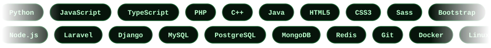

  
  
   
  
  
  

  
  
  
  

    Dasturlashga ishtiyoqli <b>Full-Stack Developer</b>. 
    4 yildan ortiq tajriba bilan foydalanuvchi uchun qulay va zamonaviy raqamli yechimlar yarataman — 
    ijodkorlik va toza kodni uyg'unlashtiraman.
  

  
  
   

| 💻 Tillar | 🎨 Frontend | ⚙️ Backend | 🗄️ Ma'lumotlar bazasi | 🧰 Asboblar |
|:---:|:---:|:---:|:---:|:---:|
|  |  |  |  |  |

  

  
  
  
    
  
    
  

  

| 🎓 Tashkilot | 📎 Sertifikat |
|:---:|:---:|
| **Coursera** | [PDF ochish](https://github.com/burxonmeliyev/burxonmeliyev/blob/main/Coursera%20G0Y4HNJQ8R25.pdf) |
| **Coursera** | [PDF ochish](https://github.com/burxonmeliyev/burxonmeliyev/blob/main/Coursera%20TCC7D3RH06VA.pdf) |
| **AI Leaders** | [PDF ochish](https://github.com/burxonmeliyev/burxonmeliyev/blob/main/BURXONJON%20MELIEV%20ILXOMJON%20O%E2%80%98G%E2%80%98LI_5MP_0369516.pdf) |
| **IT Park** | 1 ta sertifikat |

  
  
  
  
   
  
  
  
    
  
   
  

